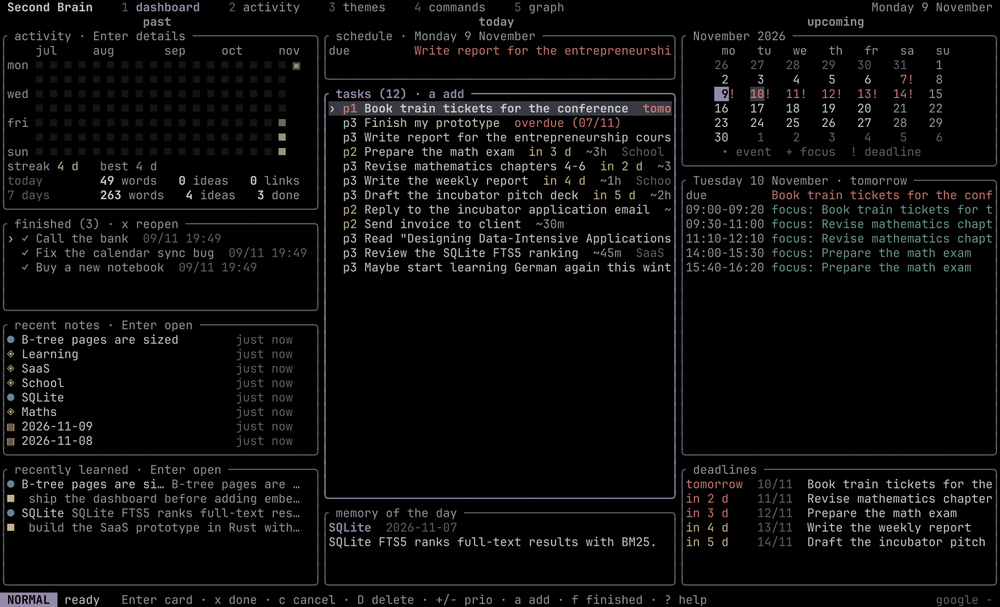

<div align="center">

# 🧠 Second Brain

**Write a daily Markdown journal. Get tasks, notes, a knowledge graph and a planned week.**
_A local-first, token-efficient second brain in Rust, with a vim-like terminal dashboard and nvim integration._

[](https://github.com/jojorequiem/second-brain/actions/workflows/ci.yml)
[](https://www.rust-lang.org/)
[](#-license)
[](#-quick-start)
[](CONTRIBUTING.md)

<p align="center">
  <a href="#-preview">Preview</a> •
  <a href="#-features">Features</a> •
  <a href="#-quick-start">Quick Start</a> •
  <a href="#%EF%B8%8F-writing-the-journal">Journal</a> •
  <a href="#%EF%B8%8F-commands">Commands</a> •
  <a href="#-editor-integration">Editor</a> •
  <a href="#-documentation">Docs</a>
</p>

</div>

---

## 🖼️ Preview

<div align="center">



</div>

---

## ✨ Features

- **Journal in, structure out**: checkboxes, dates, estimates and `+projects` are parsed by Rust; the rest goes to the model in **one batched call** per changed note, as validated JSON.
- **Knowledge graph**: grand theme › theme › item, `[[links]]` with a reason, browsable in the terminal, in an offline HTML graph, in nvim or Obsidian.
- **Planning**: deterministic scheduler, incremental replanning, daily briefing and alerts.
- **Google Calendar & Tasks**: two-way task sync to your phone, work sessions in a dedicated calendar, plain-text events (`sb event "hackathon on nov 20 and 21"`).
- **Terminal dashboard**: past · today · future at a glance, GitHub-style activity, themes tree, braille graph. English & French, 9 themes shared with nvim.
- **Cheap and safe**: ~1.5k tokens per journal, unchanged notes cost nothing, daily budget, no tools for the model, every change undoable.

---

## 🚀 Quick Start

```sh
git clone https://github.com/jojorequiem/second-brain && cd second-brain
cargo install --path . --locked      # installs `sb`

sb init                              # creates ~/second-brain (or $SB_HOME)
$EDITOR "$(sb journal)"              # write today's journal
sb ingest                            # or keep `sb daemon` running
sb dash                              # open the dashboard
```

Try it on the example vault:

```sh
export SB_HOME=/tmp/sb-demo && sb init && cp examples/vault/journal/*.md $SB_HOME/vault/journal/
sb ingest && sb dash
```

> **Model:** uses your logged-in `claude` (default) or `codex` CLI, or an Anthropic API key. With `provider.kind = "none"`, everything deterministic still works.

---

## ✍️ Writing the journal

Write freely. This syntax is understood **without any model call**:

| You write | Result |
| :-- | :-- |
| `- [ ] Write report by Friday ~2h !! +Course` | task due Friday, 2h, priority 2, project *Course* |
| `- [x] Write report` | marked done |
| `Decision: …` · `Idea: …` · `TIL: …` | decision · idea · knowledge |
| `[[Name]]` | link to a project or concept |
| `tomorrow`, `next Thursday`, `in 3 days`, `2026-11-20` | resolved dates |

Full cheatsheet (French): [docs/CHEATSHEET.md](docs/CHEATSHEET.md).

---

## ⌨️ Commands

| Command | Description |
| :-- | :-- |
| `sb dash` | Terminal dashboard (`?` for keys, `:` runs any command) |
| `sb ingest` | Process changed journals |
| `sb tasks` · `sb task add "…"` | List / manage tasks |
| `sb today` · `sb plan --apply` | Agenda · schedule work sessions |
| `sb search` · `sb ask` | Full-text search · questions about your notes |
| `sb synth` · `sb connect` | AI syntheses · link related ideas |
| `sb calendar auth` · `sb calendar sync` | Google Calendar & Tasks |
| `sb graph` | Interactive knowledge graph in the browser |
| `sb theme <name>` | Interface theme (dashboard + nvim) |
| `sb daemon` | Watch, sync and plan in the background |

Every command: `sb help`, or page 4 of the dashboard. AI commands only run when you ask.

---

## 🧩 Editor integration

- **nvim**: [contrib/nvim](contrib/nvim/README.md) opens the dashboard in a float, opens notes in place and follows the theme live.
- **Obsidian**: open `~/second-brain/vault` as a vault.
- **Any editor**: notes are plain Markdown; generated parts sit between `sb:begin` / `sb:end` markers.

---

## 📚 Documentation

| | |
| :-- | :-- |
| [Architecture & internals](docs/ARCHITECTURE.md) | memory model, guarantees, scheduler, providers, token costs, limitations |
| [Google Calendar & Tasks](docs/GOOGLE_CALENDAR.md) | one-time OAuth setup |
| [Security](SECURITY.md) | what is stored where, what reaches the model |
| [Changelog](CHANGELOG.md) | release notes |

---

## 🤝 Contributing

Issues and PRs are welcome. See [CONTRIBUTING.md](CONTRIBUTING.md).

---

## 📜 License

Dual-licensed under [MIT](LICENSE-MIT) or [Apache-2.0](LICENSE-APACHE), at your option.

<div align="center">
  <sub>Built with Rust, ratatui and SQLite. If it helps you think, consider starring the repository.</sub>
</div>
